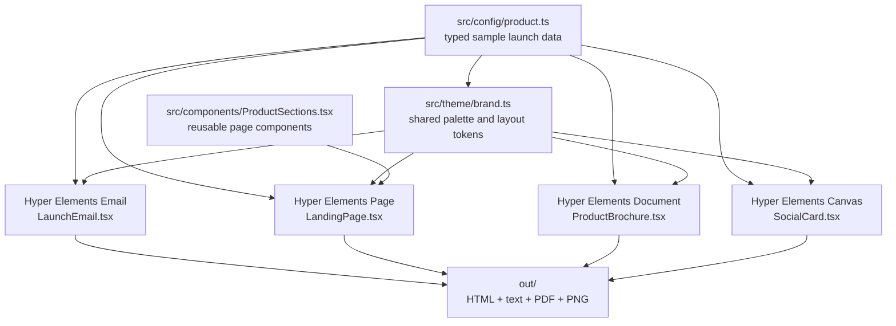

# CircuitLaunch — Hardware Product Launch Kit

> One fictional hardware product brief, four coordinated launch assets.

CircuitLaunch is a small React and TypeScript project that demonstrates how to use the official [`@hyper-elements/react`](https://www.npmjs.com/package/@hyper-elements/react) library to author a hardware product launch campaign. Its shared sample configuration describes **PulseNode Edge**, a fictional IoT gateway, and the project contains dedicated Hyper Elements designs for an email, responsive web page, A4 brochure, and social launch graphic.

## Screenshots


---

## The problem

Launching a hardware product usually means preparing several formats at once. When the email, website, brochure, and social graphic are maintained separately, product names, specifications, and brand details can drift between them.

## The solution

CircuitLaunch keeps the sample product, brand, technical specifications, application copy, and colors in one typed configuration. Each output is authored with Hyper Elements and reads from that shared source, making updates easier to keep coordinated.

## What’s included

- Typed sample configuration for brand, product, campaign, features, specs, and applications.
- Shared dark navy and electric cyan theme tokens.
- Reusable Hyper Elements components for landing-page sections.
- Four authored output designs and individual render commands.
- One command that attempts to render all four outputs.

## The four outputs

The render scripts target these files in `out/`:

| Output | Source design | Generated file(s) |
| --- | --- | --- |
| Launch email | `src/outputs/email/LaunchEmail.tsx` | `out/launch-email.html`, `out/launch-email.txt` |
| Landing page | `src/outputs/landing-page/LandingPage.tsx` | `out/landing-page.html` |
| Product brochure | `src/outputs/brochure/ProductBrochure.tsx` | `out/product-brochure.html`, `out/pulse-node-edge-brochure.pdf` |
| Social card | `src/outputs/social/SocialCard.tsx` | `out/pulsenode-edge-launch.png` (1200 × 630) |

### Screenshots

No actual screenshots or generated assets are checked in yet. The renderer scripts have not been successfully run in this environment, so no mock screenshots are shown here. The challenge requires at least one real screenshot, GIF, or video in this README before submission.

After generating and reviewing the outputs, add real screenshots to `docs/screenshots/` and embed them here, for example:

```md


```

## Architecture



## How Hyper Elements is used

The official `@hyper-elements/react` package provides the design primitives and rendering entry points used in this project:

- The email is built from the `Email` root and email-safe elements, then rendered to HTML and plain text with `render()`.
- The landing page uses the `Page` root. Its layout is assembled from reusable Hyper Elements sections, rows, columns, and text elements.
- The brochure uses the `Document` root with A4 portrait settings and explicit page components/page breaks. Its script renders document HTML and calls the package’s `@hyper-elements/react/pdf` entry point for PDF output.
- The social artwork uses the `Canvas` root at 1200 × 630 and the `renderImage()` API from `@hyper-elements/react/image` to write PNG bytes.

This is a code-authored campaign, not an Unlayer editor export. Designs use Hyper Elements components rather than ordinary HTML tags as layout substitutes.

## Shared product configuration

Edit [`src/config/product.ts`](src/config/product.ts). The `LaunchConfig` TypeScript interface documents the expected shape, and the exported `product` constant contains the fictional sample data.

It groups:

- **Brand:** name, tagline, website, contact name/email, postal address, and brand colors.
- **Product:** name, category, descriptions, launch date, CTA, image metadata, features, feature labels, benefits, and technical specifications.
- **Applications:** named use cases and descriptions.
- **Campaign:** email subject/preview, announcement headlines, product introduction, brochure title, and format-specific supporting copy.

The outputs map the same `product.product.specifications` entries into their technical sections. Product names and brand details also come from this object, so avoid adding new output-specific copies of those values.

For image output in HTML, provide an HTTPS image URL that readers can access. The current `placehold.co` image is an illustrative placeholder, not a product photograph. Update the CTA URL and `campaign.productPath` together if the destination path changes.

## Reusable components and theme

[`src/components/ProductSections.tsx`](src/components/ProductSections.tsx) defines shared landing-page sections such as the header, hero, feature list, specifications, applications, contact CTA, and footer.

[`src/theme/brand.ts`](src/theme/brand.ts) combines reusable typography/layout defaults with `product.brand.colors`. Each output imports this shared theme so the campaign stays on the same palette. Adjust the colors in the product configuration; adjust default type and layout tokens in the theme file.

## Technology stack

- React and React DOM
- TypeScript and TSX
- Node.js scripts
- `@hyper-elements/react` for email, web, document, and canvas designs/rendering
- Hyper Elements PDF and image subpath APIs used by the brochure and social-card renderers
- `tsx` for running TypeScript render scripts directly

The PDF renderer calls the documented `renderPdf()` API from `@hyper-elements/react/pdf`. Hyper Elements documents `@react-pdf/renderer` as a PDF renderer peer and `satori` plus `@resvg/resvg-js` as image-renderer peers; they are declared in `package.json`.

## Prerequisites

- Node.js with npm
- Network access to install the npm dependencies
- A supported runtime for the optional `@react-pdf/renderer`, `satori`, and `@resvg/resvg-js` rendering dependencies

The repository does not currently contain a lockfile, `node_modules`, a configured build script, or a test framework.

## Installation

From the repository root:

```sh
npm install
```

This installs the Hyper Elements library, its render peers, and the CLI. The CLI can validate and outline designs. The email-client emulator is an optional separate package; install a release compatible with the pinned Hyper Elements version if you want modeled client previews.

Then run the TypeScript check:

```sh
npm run check
```

`npm run check` is configured as `tsc --noEmit`. It has not been run successfully in the current environment because dependencies are not installed.

## Customize the sample product

1. Open `src/config/product.ts`.
2. Update the brand name, tagline, website, contact values, and `brand.colors`.
3. Update the product name, descriptions, image, features, and technical specification entries.
4. Update the `applications` and `campaign` copy for the launch.
5. If the destination path changes, update `product.callToActionUrl` and `campaign.productPath` together.
6. Run the type check and regenerate the outputs.

No database, authentication, paid API, or backend service is required by the authored project source.

## Generate the outputs

Render all four formats:

```sh
npm run render:all
```

Or render one format at a time:

```sh
npm run render:email
npm run render:landing
npm run render:brochure
npm run render:social
```

Validate and inspect a design with the installed CLI, for example:

```sh
npx hyper-elements check src/outputs/email/LaunchEmail.tsx
npx hyper-elements outline src/outputs/email/LaunchEmail.tsx
npx hyper-elements preview out/launch-email.html
```

These are modeled email-client previews; they are not inbox tests.

The landing page can be served locally after generation with:

```sh
npm run preview:landing
```

That script runs `npx serve out`. The source does not define an automated PDF preview, email inbox test, or deployment command.

## Project structure

```text
.
├── README.md
├── package.json
├── tsconfig.json
├── scripts/
│   └── render-all.mjs
└── src/
    ├── components/
    │   └── ProductSections.tsx
    ├── config/
    │   └── product.ts
    ├── outputs/
    │   ├── brochure/
    │   │   ├── ProductBrochure.tsx
    │   │   └── render.tsx
    │   ├── email/
    │   │   ├── LaunchEmail.tsx
    │   │   └── render.tsx
    │   ├── landing-page/
    │   │   ├── LandingPage.tsx
    │   │   └── render.tsx
    │   └── social/
    │       ├── SocialCard.tsx
    │       └── render.tsx
    └── theme/
        └── brand.ts
```

## Example generated assets

The render scripts are configured to produce:

```text
out/launch-email.html
out/launch-email.txt
out/landing-page.html
out/product-brochure.html
out/pulse-node-edge-brochure.pdf
out/pulsenode-edge-launch.png
```

These are expected output paths, not files included in the repository at present. Run the corresponding renderer before referencing or distributing them.

## Known limitations

- PulseNode Edge, its specifications, brand, and contact details are fictional sample data.
- The product image points to a placeholder image service and must be replaced with approved product artwork.
- Generated assets and screenshots are not currently committed.
- Dependencies have not been installed in this checkout; TypeScript checks, rendering, PDF generation, email previews, and PNG inspection have therefore not been verified here.
- There is no test framework or build script configured yet.
- `npm run preview:landing` uses `npx serve`; it is a local preview helper, not a deployment setup.
- Add and embed a genuine screenshot, GIF, or video of the rendered template before submitting to the challenge.

## License

No license file or license declaration is currently present. Add a `LICENSE` file and update this section before distributing or reusing the project under a specific license.
